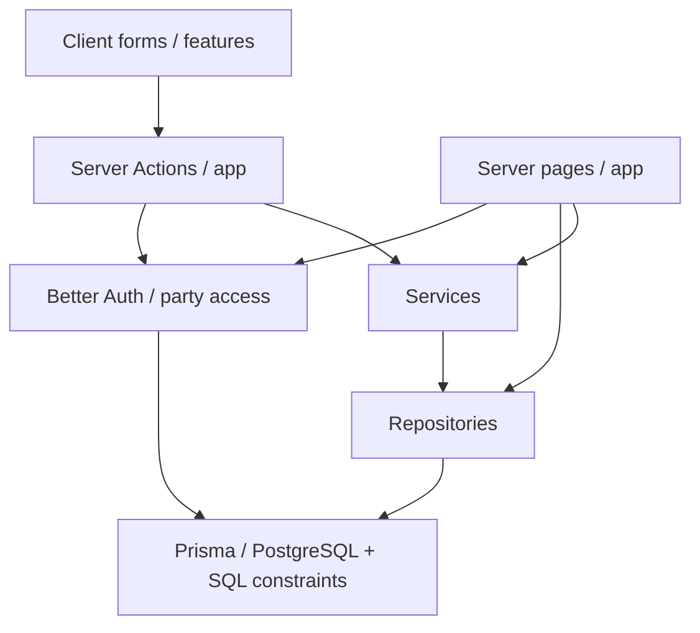

# Архитектура и инварианты

## Слои приложения

Страницы — серверные компоненты; интерактивные формы находятся в `src/features/`.
Чтение местами идёт из страницы прямо в repository. Изменения проходят через
Server Actions: Zod-проверка, определение активной группы и роли, сервис/репозиторий,
преобразование ожидаемых ошибок в типизированный результат, `revalidatePath`.
Атомарные финансовые операции находятся в repositories, чистое распределение —
в `src/server/services/sale-distribution.ts`.

Журнал действий группы записывается отдельным запросом после изменения данных.
Сбой записи журнала логируется на сервере и не превращает уже завершённое изменение
в ошибочный ответ Server Action: повтор запроса мог бы создать дубликат или повторить
необратимую операцию. Поэтому журнал помогает установить автора действий, но не
является транзакционным источником истории.

В `next.config.ts` включены `cacheComponents` и `partialPrefetching`.
Динамические части страниц используют `Suspense` и `await io()` из `next/cache`.
Layout защищённых страниц отключает Instant UI validation: получение сессии и
проверка membership выполняются на сервере и могут сделать redirect до отрисовки
целевой страницы.
API установленной версии Next.js проверяют по `node_modules/next/dist/docs/`.

## Маршруты

| URL | Назначение |
| --- | --- |
| `/` | Переход на `/dashboard` |
| `/dashboard` | Банк, остатки, последние рейды, аналитика |
| `/members` | Участники, деактивация и игровые профили |
| `/compositions` | Именованные составы и builder слотов |
| `/items`, `/items/[id]` | Каталог, поиск, классификация и история поступлений |
| `/raids`, `/raids/new` | Список и создание рейдов |
| `/raids/[id]`, `/raids/[id]/edit` | Добыча, продажи, снимок и разрешённое редактирование |
| `/sales` | Остатки и передачи участникам |
| `/ledger` | Журнал продаж, долей и передач |
| `/settings` | Название группы, сведения о резервировании базы и очистка |
| `/settings/access` | Ссылки приглашения и управление доступом |
| `/settings/telegram` | Зашифрованный bot token; только владелец |
| `/settings/activity` | Последние 100 действий менеджеров группы |
| `/profile` | Имя аккаунта для отображения |
| `/api/ledger/export` | CSV всех операций группы |
| `/api/backups/[name]` | Legacy endpoint; возвращает `410 Gone` для SQLite-архивов |

Отдельных `/members/[id]` и `/sales/[id]` нет. История продажи раскрывается
у добычи рейда и в журнале. Технические проводки не выводятся как бухгалтерский UI.

## Workspace и модель данных

Better Auth хранит пользователей и сессии в PostgreSQL. Авторизованное действие
создаёт группу и OWNER membership; активная группа читается из HttpOnly cookie и
принимается только при наличии членства. Серверный access helper проверяет сессию,
членство и роль. Клиентский `partyId` не является разрешением. Подробности:
[аккаунты и группы](./ACCOUNTS_AND_PARTIES_SPEC.md). `Item` —
общий каталог и намеренно не имеет `partyId`; рейдовый запрос проверяет предмет по
общему идентификатору, а история добычи остаётся scoped к группе.

| Сущность | Назначение |
| --- | --- |
| `PartyMember` | Персонаж с уникальным нормализованным ником и признаком активности |
| `PartyMemberProfile` | Игровые профили персонажа с классом, ролью, уровнем и заметкой |
| `PartyComposition` / `PartyCompositionMember` | Шаблон до 36 слотов «участник + профиль» |
| `Item` | Общая уникальная запись каталога предметов с классификацией; не удаляется при очистке партии |
| `Raid` / `RaidParticipant` | Рейд и исходный снимок всех активных участников со статусами |
| `LootDrop` | Отдельное поступление Item с количеством |
| `SaleTransaction` / `SaleShare` | Полученная оплата и рассчитанные доли |
| `MemberPayment` / `PaymentAllocation` | Реальная передача и покрытие имеющихся долей |
| `LedgerTransaction` / `LedgerEntry` | Внутренний журнал — источник банка и остатков |
| `PartyAuditEvent` | Автор, дата и краткое описание изменения в конкретной группе |

Ник, профиль, класс, роль и уровень сохраняются в снимке рейда. Деактивация
участника/профиля не переписывает снимок. При редактировании посещаемости обновляются
исходные строки. Обычного hard-delete исторических сущностей нет; связи используют
RESTRICT. Владелец может подтвердить очистку данных группы. Она удаляет участников и
профили, составы, рейды, добычу и финансовую историю; сохраняет аккаунты, саму группу,
членства, приглашения, Telegram-настройки, журнал действий и общий каталог предметов.
Операция выполняется транзакционно в `party-repository.ts`; PostgreSQL guards
разрешают её через локальную настройку `app.party_reset`.

При создании группы отсутствующие базовые предметы добавляются из
`prisma/seeds/lineage2-high-five-items.json` (130 названий). Существующие записи
не перезаписываются обычным открытием страницы.

## Финансовые инварианты

1. Хранение и расчёты Adena — целые `bigint`, сериализация — десятичные строки.
   Короткий формат отображения не используется для расчётов.
2. Продажа означает полученную оплату. Суммарное проданное количество не превышает
   количество LootDrop. Каждая частичная продажа распределяется независимо.
3. Только PRESENT из исходного снимка рейда получают равные доли. Largest Remainder
   сохраняет точную сумму, равные остатки разрешаются по `RaidParticipant.id`.
   Доля Party — 0%. Текущий roster не используется вместо снимка.
4. Калькулятор поддерживает weights, но sale repository передаёт расчётный вес `1`.
   `SaleShare.weightSnapshot` хранит исходный `RaidParticipant.distributionWeight`,
   включая старые значения >1: SQL требует совпадения исторических метаданных.
   Нельзя подменять snapshot расчётным весом или включать старые веса в новый расчёт.
5. Продажа, доли, сбалансированные проводки, POSTED и блокировка рейда атомарны.
   После первой продажи посещаемость и финансовые поля добычи заблокированы.
6. Передачи допускают превышение начислений и доступного банка. Отрицательный
   остаток отражает переплату/долг, рекомендация UI не является ограничением.
   Покрытие имеющихся долей — FIFO по времени получения продажи, затем времени
   создания доли и её id. Сумма сверх покрытия отражается в общем остатке.
7. Ключ идемпотентности ограничен группой: тот же ключ/параметры возвращают
   существующий результат; другие параметры с тем же ключом — конфликт.
8. POSTED финансовая история неизменяема. Возвратов, сторно, комиссий и ручных
   корректировок нет. Обычные действия не переписывают старые начисления.
9. Repositories повторяют распознанные PostgreSQL serialization/deadlock failures
   максимум три раза, с задержками 40 и 120 мс.
10. Дополнительные ограничения PostgreSQL реализованы в
    `prisma/postgresql-constraints.sql`: положительные значения, oversell,
    блокировка рейда, баланс и неизменяемость.
    Одной Prisma-схемы недостаточно.

UI-продажа и UI-передача по-разному трактуют число без суффикса. Текущий контракт
и ограничение payment-prefill описаны в [PROJECT_SPEC.md](../PROJECT_SPEC.md#денежный-ввод).
Их изменение требует явного отдельного согласования.

## Время

Дата рейда вводится в зоне браузера → преобразуется в UTC → локально отображается.
Преобразование отклоняет несуществующие и неоднозначные времена рейда при DST.
`DateInput` хранит видимый draft отдельно от нормализованного значения; неверная дата
остаётся в поле, получает связанную ошибку и блокирует submit. Форматы полей:
`ДД.ММ.ГГГГ` и `ДД.ММ.ГГГГ ЧЧ:ММ`.

## Хранение и восстановление

`DATABASE_URL` обязателен; Prisma Client uses `@prisma/adapter-pg` and a PostgreSQL
connection pool. Local development connects to the Docker Compose PostgreSQL
service; production connects to Neon through server-only environment variables.
SQLite legacy data is retained only as the source for the one-time item catalog
import. The importer opens it read-only and transfers no party or financial rows.
Authentication requires `BETTER_AUTH_URL` and `BETTER_AUTH_SECRET`. Encrypted
Telegram bot tokens require the server-only `PARTY_TOKEN_ENCRYPTION_KEY`.

Production backup and restore are managed through the selected PostgreSQL provider.
Local dumps use `pg_dump`; do not point PostgreSQL restore procedures at legacy
SQLite archives. Upload storage is not configured yet. Nullable `screenshotPath`
does not mean upload UI exists.

## Ограничения эксплуатации и проверок

- PostgreSQL schema is created by migrations under
  `prisma/migrations-postgresql/`; `db:deploy` also applies repeatable SQL guards.
- SQLite migrations and integration fixtures remain legacy material and do not
  validate the PostgreSQL runtime. PostgreSQL integration tests require a separate
  disposable test database before use as a CI gate.
- Vitest работает в Node; тесты находятся рядом с кодом. Проверяются Zod, services,
  repositories, распределение, даты и CSV. PostgreSQL integration tests требуют
  отдельный `TEST_DATABASE_URL`; SQLite backup tests оставлены как legacy tests.
  Сохраняемого браузерного набора тестов нет.
- Проверки `lint`, `typecheck`, `test`, `build` не заменяют визуальную проверку
  UI, accessibility и реальной конкуренции нескольких клиентов.
