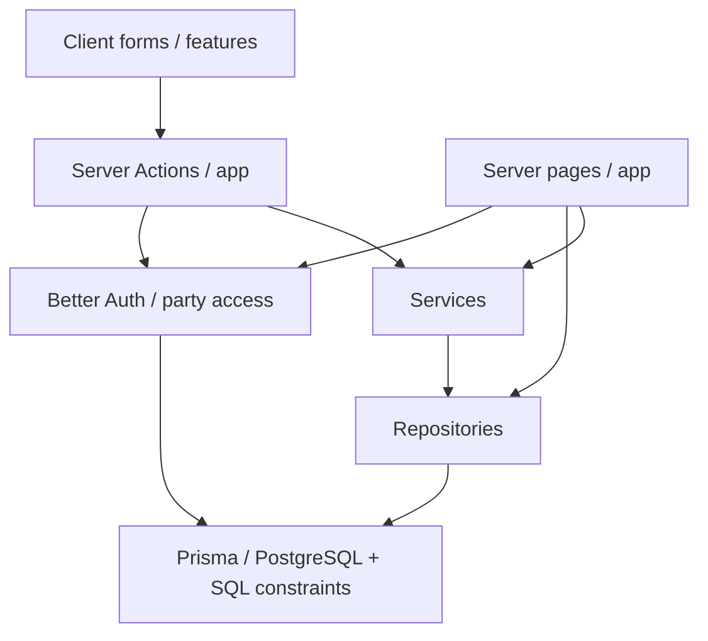

# Архитектура и инварианты

## Слои приложения

Страницы — серверные компоненты; интерактивные формы находятся в `src/features/`.
Чтение местами идёт из страницы прямо в repository. Изменения проходят через
Server Actions: Zod-проверка, определение активной группы и роли, сервис/репозиторий,
преобразование ожидаемых ошибок в типизированный результат, `revalidatePath`.
Атомарные финансовые операции находятся в repositories, чистое распределение —
в `src/server/services/sale-distribution.ts`.

Журнал действий группы записывается отдельным запросом после изменения данных.
Сбой записи журнала логируется на сервере и не превращает уже завершённое изменение
в ошибочный ответ Server Action: повтор запроса мог бы создать дубликат или повторить
необратимую операцию. Поэтому журнал помогает установить автора действий, но не
является транзакционным источником истории.

В `next.config.ts` включены `cacheComponents` и `partialPrefetching`.
Динамические части страниц используют `Suspense` и `await io()` из `next/cache`.
Layout защищённых страниц отключает Instant UI validation: получение сессии и
проверка membership выполняются на сервере и могут сделать redirect до отрисовки
целевой страницы.
API установленной версии Next.js проверяют по `node_modules/next/dist/docs/`.

## Маршруты

| URL                                 | Назначение                                                                                  |
| ----------------------------------- | ------------------------------------------------------------------------------------------- |
| `/`                                 | Переход на `/dashboard`                                                                     |
| `/dashboard`                        | Банк, остатки, последние рейды, аналитика                                                   |
| `/members`                          | Участники, деактивация и игровые профили                                                    |
| `/compositions`                     | Именованные составы и builder слотов                                                        |
| `/items`, `/items/[id]`             | Каталог, поиск, классификация и история поступлений                                         |
| `/raids`, `/raids/new`              | Список и создание рейдов                                                                    |
| `/raids/[id]`, `/raids/[id]/edit`   | Просмотр добычи и времени поступления; разрешённое редактирование рейда                     |
| `/sales`                            | Остатки и передачи участникам                                                               |
| `/loot`                             | Все поступления лута, фильтры продаж, остатки, суммы и ручной ввод продажи в модальном окне |
| `/ledger`                           | Журнал продаж, долей и передач                                                              |
| `/settings`                         | Название группы, сведения о резервировании базы и очистка                                   |
| `/settings/access`                  | Ссылки приглашения и управление доступом                                                    |
| `/settings/telegram`                | Зашифрованный bot token; только владелец                                                    |
| `/settings/activity`                | Последние 100 действий менеджеров группы                                                    |
| `/telegram`                         | История автоматического импорта, соответствия названий и разбор исключений                  |
| `/api/telegram/webhook/[webhookId]` | Приём обновлений Telegram с проверкой секретного заголовка                                  |
| `/api/telegram/notifications`       | Непрочитанные уведомления активной группы текущего пользователя                             |
| `/profile`                          | Имя аккаунта для отображения                                                                |
| `/api/ledger/export`                | CSV всех операций группы                                                                    |
| `/api/backups/[name]`               | Legacy endpoint; возвращает `410 Gone` для SQLite-архивов                                   |

Отдельных `/members/[id]` и `/sales/[id]` нет. Ручной ввод продажи доступен из
`/loot`; распознанные Telegram-продажи по-прежнему поступают автоматически. История
продаж и проводок доступна в журнале. Raid Detail показывает исходную добычу и дату,
не выводя продажи и финансовые действия. Технические проводки не выводятся как
бухгалтерский UI.

## Workspace и модель данных

Better Auth хранит пользователей и сессии в PostgreSQL. Авторизованное действие
создаёт группу и OWNER membership; активная группа читается из HttpOnly cookie и
принимается только при наличии членства. Серверный access helper проверяет сессию,
членство и роль. Клиентский `partyId` не является разрешением. Подробности:
[аккаунты и группы](./ACCOUNTS_AND_PARTIES_SPEC.md). `Item` и `Instance` имеют nullable
`partyId`: null — общий каталог, иначе запись принадлежит группе. Пользовательские
actions не меняют общие записи; ID исторических предметов сохраняются. Поиск и
выбор допускают только global-or-own, дополнительные SQL guards проверяют эту
границу для LootDrop, aliases и пресетов. Partial unique index защищает общие имена,
составная уникальность — имена группы. Стадии и каталог описаны в
[INSTANCE_CATALOG.md](./INSTANCE_CATALOG.md).

| Сущность                                         | Назначение                                                                                 |
| ------------------------------------------------ | ------------------------------------------------------------------------------------------ |
| `PartyMember`                                    | Персонаж с уникальным нормализованным ником и признаком активности                         |
| `PartyMemberProfile`                             | Игровые профили персонажа с классом, ролью, уровнем и заметкой                             |
| `PartyComposition` / `PartyCompositionMember`    | Шаблон до 36 слотов «участник + профиль»                                                   |
| `Item`                                           | Общая или собственная запись каталога с классификацией; не удаляется при очистке партии    |
| `Instance` / `ServerStage`                       | Общие/свои инстансы и глобальные публикуемые стадии                                        |
| `ServerStageConfig` / `ServerStageAuditEvent`    | Явная текущая Stage либо max available, атомарный аудит административных операций          |
| `InstanceStageLootRecommendation`                | Общие рекомендации конкретной Stage; только контролируемый import                          |
| `PartyInstanceLootPreset` / `PartyQuickLootItem` | Собственные наборы группы, независимые от Stage                                            |
| `Raid` / `RaidParticipant`                       | Рейд и исходный снимок всех активных участников со статусами                               |
| `LootDrop`                                       | Отдельное поступление Item с количеством                                                   |
| `SaleTransaction` / `SaleShare`                  | Полученная оплата и рассчитанные доли                                                      |
| `MemberPayment` / `PaymentAllocation`            | Реальная передача и покрытие имеющихся долей                                               |
| `LedgerTransaction` / `LedgerEntry`              | Внутренний журнал — источник банка и остатков                                              |
| `PartyAuditEvent`                                | Автор, дата и краткое описание изменения в конкретной группе                               |
| `PartyTelegramBotConfig`                         | Зашифрованный токен, маршрут/хеш секрета webhook, выбранные чат и бот-источник             |
| `TelegramSaleImport`                             | Сохраняемый inbox с уникальностью party/chat/message, статусом и результатом распределения |
| `TelegramItemAlias` / `TelegramImportRead`       | Соответствия названий группы и индивидуальные отметки прочтения                            |

Main хранится в `PartyMember.className`; четыре Subclass — активные
`PartyMemberProfile` с `subclassSlot` от 1 до 4. Уникальность слота ограничена
группой и персонажем. Сохранение формы атомарно обновляет Main и слоты под
FOR UPDATE участника. Удалённый Subclass деактивируется, его ссылки в будущих
шаблонах состава обнуляются; исторические RaidParticipant.profileId и snapshots
сохраняются. Старые профили мигрируют в первые четыре слота без смены ID;
лишние legacy-профили остаются до явного отключения. API создания профиля
также сериализует проверку лимита четырёх. Уровень скрыт в текущих формах и
карточках, существующие значения и исторические снимки не очищаются.

Ник, профиль, класс, роль и уровень сохраняются в снимке рейда. Деактивация
участника/профиля не переписывает снимок. При редактировании посещаемости обновляются
исходные строки. Обычного hard-delete исторических сущностей нет; связи используют
RESTRICT. Владелец может подтвердить выборочный сброс в опасной зоне настроек.
Граф зависимостей в `features/settings/reset-plan.ts` общий для UI и сервера:
продажи → выплаты; лут → продажи; рейды → лут; участники/профили → рейды и составы.
Доли, покрытия и соответствующие проводки удаляются с финансовыми сущностями.
Сброс только выплат сохраняет продажи и их проводки. Сброс продаж снимает lockedAt
рейдов, поскольку продаж больше нет. Сброс составов обнуляет compositionId у рейдов,
сохраняя снимки участников и финансы. Общий каталог не входит в граф сброса.
Аккаунты, сама группа, членства, приглашения, Telegram-настройки, соответствия названий
и журнал действий сохраняются. Inbox Telegram также сохраняется: PROCESSED остаётся
идемпотентной отметкой, но при сбросе продаж очищаются allocations и добавляется причина;
PENDING/NEEDS_REVIEW становятся IGNORED, чтобы обработка не возобновилась после сброса.
Операция в `party-repository.ts` выполняется в Serializable transaction с advisory lock
группы и FOR UPDATE родительской Party; PostgreSQL guards разрешают её через локальную
настройку `app.party_reset`. При сериализации/deadlock выполняются до трёх попыток.

При создании группы глобальные каталоги не изменяются. Административный bootstrap
предметов использует `prisma/seeds/lineage2-high-five-items.json` (130 названий),
metadata seed инстансов — `prisma/seeds/instances.json` (19 кодов). Рекомендации
дропа и опубликованные стадии seed не создаёт. Собственные записи не перезаписываются.

Stage черновика инициализируется Party Default и затем независима от его изменений.
Создание проверяет конкретные stageId/revision под shared global advisory lock,
затем берёт party advisory lock; edit и продажи используют тот же party lock.
Успешный creationKey возвращает исходный Raid до проверки изменившейся Stage.
Опубликованный набор меняется административной транзакцией под exclusive stage lock,
с revision/audit. Raid.stageId и его snapshots остаются неизменными при edit.
Эти ограничения дополняет `prisma/catalog-constraints.sql`; оба SQL-файла нужны при deploy.

## Финансовые инварианты

1. Хранение и расчёты Adena — целые `bigint`, сериализация — десятичные строки.
   Короткий формат отображения не используется для расчётов.
2. Продажа означает полученную оплату. Суммарное проданное количество не превышает
   количество LootDrop. Каждая частичная продажа распределяется независимо. При
   ручной продаже из объединённой карточки партия списывается FIFO по времени
   поступления; сервер под блокировкой группы проверяет общий остаток. Если одна
   операция затронула несколько поступлений, её сумма делится по количеству между
   созданными операциями, сохраняя точную исходную сумму. Каждая часть затем
   распределяется по снимку участников соответствующего рейда.
3. Только PRESENT из исходного снимка рейда получают равные доли. Largest Remainder
   сохраняет точную сумму, равные остатки разрешаются по `RaidParticipant.id`.
   Доля Party — 0%. Текущий roster не используется вместо снимка.
4. Калькулятор поддерживает weights, но sale repository передаёт расчётный вес `1`.
   `SaleShare.weightSnapshot` хранит исходный `RaidParticipant.distributionWeight`,
   включая старые значения >1: SQL требует совпадения исторических метаданных.
   Нельзя подменять snapshot расчётным весом или включать старые веса в новый расчёт.
5. Продажа, доли, сбалансированные проводки, POSTED и блокировка рейда атомарны.
   После первой продажи посещаемость и финансовые поля добычи заблокированы.
6. Передачи допускают превышение начислений и доступного банка. Отрицательный
   остаток отражает переплату/долг, рекомендация UI не является ограничением.
   Покрытие имеющихся долей — FIFO по времени получения продажи, затем времени
   создания доли и её id. Сумма сверх покрытия отражается в общем остатке.
7. Ключ идемпотентности ограничен группой: тот же ключ/параметры возвращают
   существующий результат; другие параметры с тем же ключом — конфликт.
8. POSTED финансовая история неизменяема. Возвратов, сторно, комиссий и ручных
   корректировок нет. Обычные действия не переписывают старые начисления.
9. Repositories повторяют распознанные PostgreSQL serialization/deadlock failures
   максимум три раза, с задержками 40 и 120 мс.
10. Дополнительные ограничения PostgreSQL реализованы в
    `prisma/postgresql-constraints.sql`: положительные значения, oversell,
    блокировка рейда, баланс и неизменяемость.
    Одной Prisma-схемы недостаточно.

UI-продажа и UI-передача по-разному трактуют число без суффикса. Текущий контракт
и ограничение payment-prefill описаны в [PROJECT_SPEC.md](../PROJECT_SPEC.md#денежный-ввод).
Их изменение требует явного отдельного согласования.

## Telegram: границы транзакций

`src/server/telegram/` содержит transport, parser, подключения, обработку и queries.
Webhook проверяет секрет и источник до импорта. Полученное сообщение сохраняется
в inbox как PENDING до финансовой обработки. Один Serializable transaction с
advisory lock группы планирует FIFO-распределение, вызывает общий
`createPartySaleRecord` для каждой части, сохраняет PROCESSED и системную audit-запись.
Доли, проводки и `lockedAt` рейдов входят в эту же транзакцию.

При ошибке откатываются все продажи сообщения; отдельная транзакция записывает
NEEDS_REVIEW. Временная ошибка оставляет PENDING и возвращает Telegram 503 для
повторной доставки. Идемпотентность основана на party/chat/message, а не update ID.
Для пересылок в личку receiving bot источник проверяется по Telegram forward_origin;
принимается только выбранный чат и исходный бот. Повтор пересылки определяется
под тем же lock по исходному боту, времени оригинала и hash текста, включая смену
выбранного чата. Время продажи берётся из оригинала. Telegram не передаёт ID
личного оригинала: одинаковые тексты одного бота в одну секунду считаются повтором.
Повторный разбор разрешён только ADMIN/OWNER и только для PENDING/NEEDS_REVIEW.
Редактирование учтённого сообщения не переписывает финансовую историю.

Подключение, замена и отключение бота сериализуют изменения конфигурации и
Telegram API calls с обработкой сообщений. Токен и секрет заголовка не выдаются
клиенту; клиенты получают только состояние и безопасные метаданные. Polling
уведомлений в браузере читает inbox раз в 20 секунд, не принимает продажи.
Формат и ограничения — в [TELEGRAM_SALES_INGESTION.md](./TELEGRAM_SALES_INGESTION.md).

## Время

Дата рейда вводится в зоне браузера → преобразуется в UTC → локально отображается.
Преобразование отклоняет несуществующие и неоднозначные времена рейда при DST.
`DateInput` хранит видимый draft отдельно от нормализованного значения; неверная дата
остаётся в поле, получает связанную ошибку и блокирует submit. Форматы полей:
`ДД.ММ.ГГГГ` и `ДД.ММ.ГГГГ ЧЧ:ММ`.

## Хранение и восстановление

`DATABASE_URL` обязателен; Prisma Client использует `@prisma/adapter-pg` и пул
PostgreSQL. Разработка подключается к Docker Compose PostgreSQL, приложение на
Vercel — к Neon через серверные production-переменные. Репозиторий подключён к
Vercel; push в `master` запускает production-сборку с миграциями и SQL guards.
Preview не получает production-подключение: ему нужна отдельная БД и секреты.

Локальная production-сборка с `.env.production.local` использует ту же Neon БД,
что и размещённое приложение; изменения данных общие. Этот файл читает Next.js,
но не Prisma CLI с `dotenv/config`. `DIRECT_URL` имеет приоритет над `DATABASE_URL`
для Prisma CLI и указывает на прямое подключение без пула. Авторизация требует
`BETTER_AUTH_URL` и `BETTER_AUTH_SECRET`; Telegram-токены — серверный
`PARTY_TOKEN_ENCRYPTION_KEY`. Правила сред и запуска: [DEPLOYMENT.md](./DEPLOYMENT.md).

SQLite сохраняется только как источник однократного импорта общего каталога.
Импортёр читает её read-only и не переносит партии или финансовые записи.

Для production backup/restore используют Neon; отдельного задания резервирования
в репозитории нет. Локальные dumps создаются через `pg_dump`; legacy SQLite-архивы
не восстанавливают PostgreSQL. Хранилище загрузок пока не настроено. Nullable
`screenshotPath` не означает наличие интерфейса загрузки.

## Ограничения эксплуатации и проверок

- PostgreSQL schema is created by migrations under
  `prisma/migrations-postgresql/`; `db:deploy` also applies repeatable SQL guards.
- SQLite migrations and integration fixtures remain legacy material and do not
  validate the PostgreSQL runtime. PostgreSQL integration tests require a separate
  disposable test database before use as a CI gate.
- Vitest работает в Node; тесты находятся рядом с кодом. Проверяются Zod, services,
  repositories, распределение, даты и CSV. PostgreSQL integration tests требуют
  отдельный `TEST_DATABASE_URL`; SQLite backup tests оставлены как legacy tests.
  Сохраняемого браузерного набора тестов нет.
- Проверки `lint`, `typecheck`, `test`, `build` не заменяют визуальную проверку
  UI, accessibility и реальной конкуренции нескольких клиентов.
